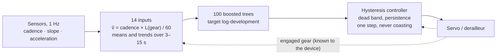

# AutoGear project extension: learning to shift without a torque sensor

**Embedded ML for a low-cost automatic derailleur.** This repository extends AutoGear, the
four-student project of the CentraleSupélec entrepreneurship track (2025–2026) in which my team and I
built the *Shifter Pro*, a device that turns the derailleur of an ordinary bicycle into an automatic
one. It asks whether a statistical model, running on the
prototype's Arduino with only the prototype's sensors, can choose gears better than a decision table,
even a table given the pedalling torque the product deliberately does without.

📄 **Report:** [`report/autogear_extension_report.pdf`](report/autogear_extension_report.pdf) (IEEE format, 10 pages)

| | Retained policy | Best decision table (with torque) |
|---|---|---|
| Agreement with the rider, within one gear (closed-loop replay, 14 tests) | **87.0 %** | 80.8 % |
| Tests won | **13 / 14** | — |
| Shifts per hour (rider: 95) | **95** | 112 |
| Uses a torque sensor | **no** | yes |
| Firmware footprint on the Cortex-M4F | **14.9 KB flash, 316 B RAM** | — |

## Motivation

The Shifter Pro targets urban and occasional cyclists, for whom constant gear management is a source
of fatigue and hesitation. Its price target sets the rules:

- **no torque sensor**, the most direct measure of effort but one of the most expensive parts of an
  automatic drivetrain;
- **only the prototype's sensors**: Hall cadence sensor, 6-axis IMU and barometer on an
  Arduino Nano 33 BLE Sense Rev2 (no GPS, no wheel-speed sensor);
- **embedded inference** on a 64 MHz Cortex-M4F with 1 MB of flash and 256 KB of RAM;
- **mechanical rules**: one decision per second, one gear step at a time, no shift while coasting.

The plan was to learn the decision logic from our own rides recorded with the prototype. Those
recordings never took place, and the prototype is no longer available. This extension rebuilds the
missing data from public sources and answers the question in simulation.

## Research question

> Can a statistical model, fed only with what the prototype measures in real time, make better gear
> decisions than a decision table, even when the table is given the torque the product does without?

What makes it hard: effort is unobserved (partial observability); riders shift on only 2.6 % of
seconds (class imbalance); the right instant to shift is ambiguous; the policy's own gear changes the
cadence it sees next (closed loop); there is no first-party data, little data per rider, a
microcontroller budget, and no prototype to test on.

## Approach



1. **Rebuild the dataset the prototype would have recorded** (`src/autogear/data`, `gears.py`).
   18.9 h of 1-Hz rides by six cyclists from six public files, reduced to quantities the device can
   compute. The rider's gear is recovered from the speed-to-cadence ratio with a Viterbi decoder and
   checked on a ride with real Shimano Di2 gear data: 84 % of pedalling seconds correct.
2. **Judge every policy in closed loop** (`replay.py`, `protocol.py`). Each policy rides the recorded
   rides second by second with its own gears; its cadence is recomputed at unchanged speed. 14
   within-rider tests, with decision parameters chosen by nested cross-validation and frozen.
3. **Reformulate the problem** (`policies/targets.py`, `controller.py`). Instead of classifying rare
   shift events, regress the development of the gear the rider will want, at every second, from 14
   inputs that do not depend on the gear chosen, and let a hysteresis controller decide when to shift.
4. **Ship it to the microcontroller** (`export_c.py`, `firmware/`). The trees are exported as
   complete binary trees in C arrays; a C99 library computes the inputs, runs the trees and the
   controller, and is checked against the Python reference.

## Findings

1. **The formulation matters more than the model.** The event classifier planned during AutoGear
   (two-stage boosted trees on a raw 30-s window) agrees with the rider within one gear only 66.0 % of
   the time, below a constant-cadence decision table (78.8 %). On the new target, even a **172-byte
   linear regression** beats every decision table (84.8 %, 12 of 14 tests).
2. **Without torque, the learned policy beats a decision table with torque**: 87.0 % against 80.8 %,
   13 of 14 tests, shifting as often as the rider (95 per hour) and reversing 0.2 % of its shifts.
3. **Torque adds almost nothing to a decision table** (+0.3 points from R1 to RT). What a table lacks
   is the rider's habits and a target steady enough to act on quickly, which the model learns from
   the recent history of speed and slope.
4. **The model follows rather than anticipates.** Predicting 0 or 8 s ahead changes agreement by less
   than half a point; the controller's persistence sets the timing (shifts about 1.7 s after the
   rider's). Faster downshifts (1 s instead of 3 s) raise agreement to 88.0 %.
5. **Offline scores are misleading.** The event classifier's offline F1 correlates at 0.25 with how it
   actually rides; only closed-loop replay can select a shifting policy.
6. **Personalisation is needed.** Trained on five riders and tested on the sixth, the learned policy
   falls to 72.5 %, below the torque-aware table (75.2 %): what it learns is a rider's habits, and they
   do not transfer. The product must learn each user, starting from a decision table.
7. **It fits the hardware with room to spare**: 14,944 bytes of flash (1.5 % of the board) and
   316 bytes of state; exactly 400 comparisons per decision; the C port reproduces the Python
   predictions exactly.

**Limits.** Labels are reconstructed, the closed loop is simulated with speed held fixed, the
sensors of the public rides differ from the prototype's, and the evidence is 18.9 h from six riders.
The results suggest the learned policy is better and make it reasonable to expect it to be at least
as good as a decision table, but only a field test can confirm it.

## Repository layout

```
src/autogear/            Python package
  data/                  pinned public sources, FIT reader, dataset reconstruction
  gears.py               gear levels and Viterbi reconstruction, validation on Di2
  features.py            the 14 device inputs (gear-independent by construction)
  controller.py          hysteresis controller (optional asymmetric persistence)
  replay.py              closed-loop measures, shift delays
  protocol.py            within-rider and cross-rider protocols, nested selection
  policies/              decision tables R0/R1/RT, target models, event classifier
  export_c.py            complete-tree export to C arrays
scripts/01..11           one script per step of the study (see below)
results/                 JSON results and summary.md (every number of the report)
figures/                 figures of the report (PDF and PNG)
firmware/autogear_ml/    C99 / Arduino library, generated model, example sketch
firmware/host_test/      host test against the Python reference
report/                  LaTeX source and PDF of the report
tests/                   unit tests (pytest)
```

## Reproduce

```bash
python -m pip install -r requirements.txt && python -m pip install -e .
make all          # download, rebuild, run every experiment, export the firmware, draw the figures
make test         # unit tests
make -C firmware test size
```

| Step | Script | Output | Time (2 cores) |
|---|---|---|---|
| Download the six public files (pinned, checksummed) | `01_download_sources.py` | `data/raw/` | seconds |
| Rebuild the 1-Hz dataset | `02_build_dataset.py` | `data/processed/` | 10 s |
| Validate the gear reconstruction on Di2 | `03_validate_gear_reconstruction.py` | `results/gear_reconstruction_validation.json` | 5 s |
| Event classifier (first approach) | `04_event_classifier_baseline.py` | `results/event_classifier.json` | 7 min |
| Decision tables and target models, 14 tests | `05_target_models_vs_tables.py` | `results/target_policies.json` | 15 min |
| Shift-timing sweep | `06_timing_sweep.py` | `results/timing_sweep.json` | 7 min |
| Cross-rider protocol | `07_cross_rider.py` | `results/cross_rider.json` | 5 min |
| Analyse the model trained on all data | `08_analyse_model.py` | `results/model_analysis.json` | 10 s |
| Export to C, write test vectors | `09_export_firmware_model.py` | `firmware/autogear_ml/src/ag_model_data.*` | 10 s |
| Figures, summary | `10_make_figures.py`, `11_summarise_results.py` | `figures/`, `results/summary.md` | seconds |

The data files are not redistributed; each keeps its own licence (see [`data/README.md`](data/README.md)).

## Credits

The Shifter Pro prototypes were built by the AutoGear team: Tancrède Amiel, Corentin Hesry,
Vincent Lucien and Maxime Poulain. This extension (dataset reconstruction, experiments, firmware
library, report) is by Tancrède Amiel, October 2026.

## Licence

Noncommercial use only (see [`LICENSE`](LICENSE)). Code: [PolyForm Noncommercial 1.0.0](https://polyformproject.org/licenses/noncommercial/1.0.0). Report, figures and documentation: [CC BY-NC 4.0](https://creativecommons.org/licenses/by-nc/4.0/). Public data: their respective licences. For commercial use, contact the author.
